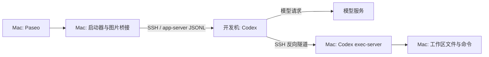

# Paseo Codex Remote Bridge

让 Mac 上的 Paseo 使用 SSH 开发机上的 Codex，同时让 Codex 的文件和命令工具回到 Mac 工作区执行。附带图片输入桥接，解决远端 Codex 无法读取 Mac 临时附件路径的问题。

这是独立的启动脚本和 Python 程序，通过 Paseo 的自定义 provider 接入。无需修改 Paseo 或 Codex 的源码。



图片在 Mac 上读取，转换成内嵌 `image` 输入后随消息发给远端 Codex；普通文本和其它协议消息继续传递。图片会进入模型输入，与直接上传图片的用途相同。

## 换电脑复用

在新 Mac 安装 Paseo、Python 3.9+、OpenSSH 和支持 `exec-server` 的 Codex CLI；开发机需要 Codex CLI、SSH 登录及对应账号的正常登录状态。

```sh
git clone git@github.com:xilinshancun/paseo-codex-remote-bridge.git
cd paseo-codex-remote-bridge

python3 scripts/install.py \
  --ssh-host devbox \
  --profile codex-remote \
  --remote-codex-home '~/.codex-remote' \
  --remote-codex-bin '~/.local/bin/codex' \
  --local-codex-bin "$HOME/.local/bin/codex" \
  --port 18733
```

`devbox` 是你在 `~/.ssh/config` 中配置的主机别名。安装器默认生成文件到 `~/.local/share/paseo-codex-remote-bridge/codex-remote/`，也可用 `--install-dir` 指定其它仓库外目录。

**安装器只生成文件。** 按 [安装与迁移说明](docs/setup.md) 完成 SSH、远端工具环境、两个本地服务和 Paseo provider 的接入，再开始会话。新电脑不需要重新开发桥接逻辑。

## 更新

```sh
git pull --ff-only
python3 scripts/install.py --update \
  --install-dir "$HOME/.local/share/paseo-codex-remote-bridge/codex-remote"
```

更新只替换三个运行时文件，保留机器配置、连接 token 和服务配置。已启动的 Codex app-server 仍运行旧进程；在自己的会话空闲后重连即可加载新代码。

## 文件与验证

| 文件 | 用途 |
| --- | --- |
| `src/paseo_codex_remote_bridge/launcher.py` | 读取实例配置，安全引用参数并通过 SSH 启动远端 Codex |
| `src/paseo_codex_remote_bridge/image_bridge.py` | 转换 app-server 的本地图片输入，传递进程信号及退出状态 |
| `scripts/install.py` | 生成实例、provider 配置片段、launchd 配置和连接凭证 |
| `tests/` | 图片协议、子进程退出、安装权限、更新保留及参数引用测试 |

本地运行测试：

```sh
python3 -m unittest discover -s tests -v
```

GitHub Actions 在 macOS 和 Linux 上运行测试。它验证代码和生成文件，不登录开发机、不启动模型，也不替代实际电脑上的接入检查。Python 3.9/3.10 可运行程序；测试中的 TOML 解析检查需要 Python 3.11+ 的 `tomllib`。

当前实现源自已实测的 Paseo 0.15.1、Mac Codex CLI `0.165.0-alpha.1.2`、Linux Codex CLI `0.167.0` 组合。原图片桥接已经在真实 Paseo 会话中完成读图验证；可配置安装器另外通过本地回归测试。升级这些外部程序后仍需执行 [接入检查](docs/setup.md#接入检查)。

## 适用范围

- 本地服务安装面向 macOS，远端启动面向采用兼容 POSIX shell 的 SSH 开发机。
- 图片桥接处理 `turn/start`、`turn/steer` 中的 `localImage`，支持识别 PNG、JPEG、GIF、WebP。模型本身支持哪些图片格式仍由所选模型决定。
- 普通 CLI `codex exec --image` 和其它文件附件路径不在此桥接范围。
- SSH、Codex 登录及 Paseo 配置由使用者管理。仓库不保存账号登录文件、实际机器配置或连接 token。
- 现有图片桥接保留了 `codex-e image bridge` 的诊断前缀；它不会限制所用 Codex 账号或 provider 名称。

协议参考：[Codex app-server](https://learn.chatgpt.com/docs/app-server)。本仓库是独立集成工具，并非 Paseo 或 OpenAI 官方扩展。
