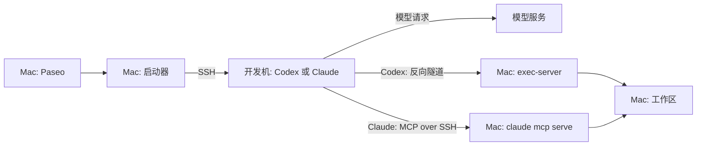

# Paseo 远程账号桥

让 Mac 上的 Paseo 使用 SSH 开发机上的 Codex 或 Claude Code 账号。模型请求在开发机上发出，项目文件和命令留在 Mac。

这是独立的启动脚本。通过 Paseo 的自定义 provider 接入，不改 Paseo 或 Codex / Claude 的源码。

Codex 和 Claude 的目标相同，传输不同。不要把 Claude 装成 Codex 的 exec-server，也不要给 Codex 配 Claude 的 MCP 桥。

| | Codex | Claude Code |
| --- | --- | --- |
| 开发机上跑的进程 | `codex app-server` | `claude` 的 stream-json |
| 工具如何回到 Mac | 本机 `exec-server`，SSH 反向隧道 | 同一条 SSH 上的 MCP，`mcp__mac__*` |
| Mac 上的常驻服务 | exec-server 和 `ssh -N -R` | 无 |
| 登录放在哪 | 开发机的 `CODEX_HOME` | 开发机的 Claude Code 登录 |
| 生成连接凭证 | 有，`auth_bearer_token` | 无 |



## 给执行接入的 agent

按下面的顺序做。做完之前不要向用户声称已经接通。

不要把这些文件提交进本仓库，也不要打印它们：

- 开发机上的 `auth.json`、Claude 凭证、任何 access token / refresh token
- 安装目录里的 `exec-server.token`、`remote-environments.toml`、`bridge.json`
- SSH 私钥、`known_hosts`、带真实 IP 或密钥路径的启动脚本

安装器只生成文件，不连 SSH，不改 `~/.paseo/config.json`，不 `launchctl bootstrap`。这三步由你在生成之后做。

### 1. 确认两端

Mac 需要 Paseo、Python 3.9+、OpenSSH，以及对应的本机 CLI。开发机需要免密 SSH（`BatchMode=yes` 不会问密码）和对应 CLI。

```sh
python3 --version
ssh -T -o BatchMode=yes devbox 'echo ok'
```

把 `devbox` 换成用户 `~/.ssh/config` 里的 Host 别名。密钥和主机指纹写在 SSH 配置里，不要写进本仓库的脚本。

### 2. 在开发机登录账号

每个账号用自己的配置目录。不要把 Mac 上另一个账号的 `auth.json` 拷过去，也不要互相覆盖。

Codex：

```sh
ssh -t devbox 'CODEX_HOME="$HOME/.codex-remote" "$HOME/.local/bin/codex" login --device-auth'
```

把设备码交给用户，用这个账号在浏览器里完成。然后再查：

```sh
ssh -T -o BatchMode=yes devbox 'CODEX_HOME="$HOME/.codex-remote" "$HOME/.local/bin/codex" login status'
```

Claude Code：

```sh
ssh -t devbox '"$HOME/.local/bin/claude" auth status || "$HOME/.local/bin/claude" login'
```

网站登录不够。开发机上的 `claude auth status` 必须是已登录。

### 3. 生成安装目录

在本仓库根目录执行。目录不能已存在，也不能放在仓库里面。同一台开发机上的每个账号用不同的 `--profile`。Codex 还要不同的 `--port` 和 `--remote-codex-home`。

Codex：

```sh
python3 scripts/install.py \
  --agent codex \
  --ssh-host devbox \
  --profile codex-remote \
  --remote-codex-home '~/.codex-remote' \
  --remote-codex-bin '~/.local/bin/codex' \
  --local-codex-bin "$HOME/.local/bin/codex" \
  --port 18733 \
  --install-dir "$HOME/.local/share/paseo-codex-remote-bridge/codex-remote"
```

Claude：

```sh
python3 scripts/install.py \
  --agent claude \
  --ssh-host devbox \
  --profile claude-remote \
  --remote-claude-bin '~/.local/bin/claude' \
  --local-claude-bin "$HOME/.local/bin/claude" \
  --remote-session-root '~/.claude/paseo-mac-workspaces' \
  --install-dir "$HOME/.local/share/paseo-codex-remote-bridge/claude-remote"
```

Codex 会生成 `exec-server.token` 和 `remote-environments.toml`。环境字段名是 `auth_bearer_token`。写成 `auth_token` 时，Codex 会拒绝解析并退出。Claude 不生成这两份文件。

再加一个账号时换 profile、安装目录，以及 Codex 的端口和 `CODEX_HOME`。不要复用正在使用的端口或远端配置目录。

### 4. 安装远端环境并启动 Mac 服务

只对 Codex 做这一节。Claude 跳到第 5 节。

远端还没有 `environments.toml` 时：

```sh
BRIDGE_DIR="$HOME/.local/share/paseo-codex-remote-bridge/codex-remote"
ssh devbox 'umask 077; mkdir -p "$HOME/.codex-remote"; test ! -e "$HOME/.codex-remote/environments.toml" && (set -C; cat > "$HOME/.codex-remote/environments.toml")' \
  < "$BRIDGE_DIR/remote-environments.toml"
```

已有 `environments.toml` 时先备份，只合并这一份环境的 `url` 和 `auth_bearer_token`，不要覆盖别的账号。

确认端口空闲后注册服务。把 profile 名替换到 plist 文件名和 label 里：

```sh
mkdir -p "$HOME/Library/LaunchAgents"
cp -n "$BRIDGE_DIR/exec-server.plist" \
  "$HOME/Library/LaunchAgents/local.paseo-codex-remote-bridge.codex-remote.exec-server.plist"
cp -n "$BRIDGE_DIR/ssh-tunnel.plist" \
  "$HOME/Library/LaunchAgents/local.paseo-codex-remote-bridge.codex-remote.ssh-tunnel.plist"
launchctl bootstrap "gui/$(id -u)" \
  "$HOME/Library/LaunchAgents/local.paseo-codex-remote-bridge.codex-remote.exec-server.plist"
launchctl bootstrap "gui/$(id -u)" \
  "$HOME/Library/LaunchAgents/local.paseo-codex-remote-bridge.codex-remote.ssh-tunnel.plist"
```

服务只监听 Mac 和开发机的 loopback。不要把反向隧道改成对公网开放。

### 5. 合并 Paseo provider

打开安装目录的 `provider.json`。把里面的那一个 provider 合并进 Mac 的 `~/.paseo/config.json` 的 `agents.providers`。保留文件里的其它 provider。不要用片段覆盖整个配置。

生成结果的形状：

```json
{
  "agents": {
    "providers": {
      "codex-remote": {
        "extends": "codex",
        "label": "codex-remote",
        "command": ["/absolute/installation/path/codex-remote"]
      }
    }
  }
}
```

Claude 的片段是 `"extends": "claude"`，命令指向 `claude-remote`，并带 `env.CLAUDE_CONFIG_DIR` 指向安装目录。原样合并，不要删掉这个 env。

然后让正在运行的 Paseo 重新加载配置，不要重启守护进程，除非 reload 明确说某项必须重启：

```sh
paseo daemon reload
paseo provider models codex-remote --json
```

`paseo` 不在 `PATH` 时，用这台机器上 Paseo CLI 的实际路径，并对准正在使用的 `~/.paseo`，而不是另一个开发用的 home。Claude 把命令里的 provider 名换成 `claude-remote`。

模型列表返回错误时，先看错误正文。Codex 的 `unknown field auth_token` 表示远端 `environments.toml` 字段名错了。改完配置后，Paseo 可能仍显示上一次的失败；对这个 provider 再刷新一次模型列表，不要只看旧界面。

### 6. 验证

```sh
"$BRIDGE_DIR/codex-remote" --version
```

Claude 用安装目录里的 `claude-remote auth status`。

然后在 Paseo 里用这个 provider 开一个短会话：

1. 让它在 Mac 工作区执行 `pwd`，并读一个你指定的、不含秘密的文件。确认读到的是 Mac 上的路径，不是开发机上的家目录。
2. Codex 再传一张图片。不应出现“Mac 临时路径在开发机上不存在”。
3. 结束这个测试会话。

`--version` 和模型列表都不能代替这两步。

## 多个账号

Codex E、F 这一类账号就是上面的 Codex 流程各做一遍：同一台开发机、不同 `CODEX_HOME`、不同端口、不同 Paseo provider。Claude Azure 这一类是 Claude 流程：同一台开发机上的 Claude 登录，Mac 上不开放端口。三条都不要共用一份远端家目录或同一个本地端口。

## 更新

```sh
git pull --ff-only
python3 -m unittest discover -s tests -v
python3 scripts/install.py --update --install-dir "$BRIDGE_DIR"
```

`--update` 只替换运行时代码，保留 `bridge.json`、provider 片段和 Codex 连接凭证。已经在跑的会话要空闲后重连才加载新代码。

## 不要提交的文件

本仓库的 `.gitignore` 排除生成的安装目录、`auth.json`、`*.token`、`bridge.json`、`provider.json`、`remote-environments.toml`、SSH 私钥和 `known_hosts`。这些文件留在各自电脑上。公开仓库里只有安装器和运行时代码。

如果一份已跟踪的历史里出现过凭证，从历史里删掉并轮换该凭证。只在工作区删除是不够的。

## 范围

- Mac 服务安装使用 launchd。开发机是支持 POSIX shell 的 SSH 主机。
- Codex 图片桥处理 `turn/start` 和 `turn/steer` 里的 `localImage`（PNG、JPEG、GIF、WebP）。`codex exec --image` 不在范围内。
- Claude 桥把 Bash、Read、Write、Edit、NotebookEdit、TaskStop 留在 Mac。远端目录只存会话，不是项目检出。
- 诊断前缀 `codex-e image bridge` 是历史文案，不表示只能用于某个账号。

协议参考：[Codex app-server](https://learn.chatgpt.com/docs/app-server)。本仓库不是 Paseo 或 OpenAI / Anthropic 的官方扩展。Codex 的更多检查表在 [docs/setup.md](docs/setup.md)。
